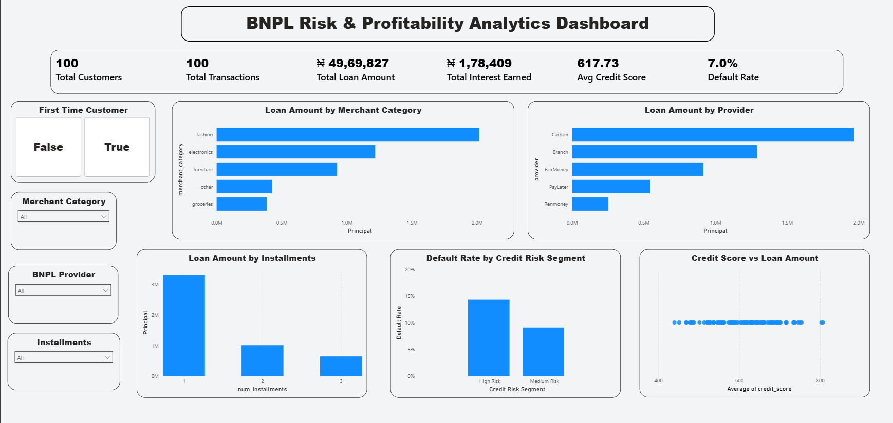

# 💳 BNPL Risk & Profitability Analytics & Underwriting Engine

An end-to-end FinTech credit risk intelligence system combining **Executive Business Intelligence (Power BI)**, **Predictive Default Underwriting (Machine Learning)**, and an **Interactive Live Decisioning Web App (Streamlit)**.

## 🚀 Live Interactive Portal

Test real-time borrower underwriting, default probability ($PD$), and Expected Loss ($EL$) calculations live:

👉 [**Launch Streamlit Underwriting Engine**](https://kushagramishra458-bnpl-risk-profitability-analytics-app-wwcr42.streamlit.app/)

---

## 📌 Executive Summary

Buy Now, Pay Later (BNPL) platforms operate on thin merchant discount margins ($2\% - 4\%$) with short repayment windows (typically 30–90 days). Because conventional credit bureaus lack real-time visibility into micro-credit velocity, lenders face two competing pressures:

1. **Portfolio Quality:** Unchecked default rates quickly erode merchant commissions.
2. **Growth & GMV:** Overly aggressive cutoffs turn away creditworthy customers and reduce transaction volume.

This project delivers a complete risk-management lifecycle:

* **Descriptive Intelligence:** An executive Power BI dashboard analyzing historical portfolio exposure, merchant category delinquency, and provider performance.
* **Predictive Underwriting:** A machine learning pipeline estimating calibrated Probability of Default ($PD$).
* **Decision Engineering:** Live threshold optimization matching unit economics, Expected Loss ($EL$), and regulatory delinquency buckets (Basel II / Special Mention Accounts).

---

## 🛠️ Tech Stack & Architecture

| Layer | Tools & Technologies | Focus Area |
| :--- | :--- | :--- |
| **Business Intelligence** | Power BI, DAX, Star Schema Modeling | Portfolio Monitoring, Cohort Delinquency, Merchant Risk |
| **Machine Learning** | Python, Scikit-Learn, Pandas, NumPy | Probability of Default ($PD$), Pipeline Engineering, Calibration |
| **Model Serving / UI** | Streamlit Community Cloud, Python 3.12 | Real-Time Underwriting Portal, What-If Profitability Simulator |
| **Version Control & CI** | Git, GitHub | Production Code Repository & Automated Deployment |

```text
[Raw BNPL Transactions & Credit Logs]
                 │
        ┌────────┴──────────────────────────┐
        ▼                                   ▼
[Power BI Executive Suite]        [ML Feature & Preprocessing Pipeline]
  ├── Delinquency Tracking (30-90 DPD)├── Encoding & Debt-to-Income Scaling
  ├── Merchant & Provider Exposure   ├── Calibrated Probability of Default (PD)
  └── DAX Risk Segmentation Engine  └── Scikit-Learn Pipeline Serialization (.pkl)
                                                    │
                                                    ▼
                                  [Streamlit Cloud Underwriting App]
                                    ├── Real-time Scorecard & Decision
                                    └── Expected Loss ($EL$) Calculation
```

---

## 📊 1. Descriptive Intelligence: Power BI Dashboard

The executive dashboard tracks portfolio health, transaction volumes, and delinquency patterns across merchant segments.



### Core Portfolio KPIs
* **Total Customers & Transactions:** Aggregate customer base and checkout transaction volume.
* **Financed GMV (Principal):** Total loan capital disbursed across providers.
* **90-Day Delinquency Rate:** Percentage of loans moving into 90+ DPD default status.
* **Interest & Fee Revenue:** Revenue generated from installment financing fees.

### Key DAX Measures

**Portfolio Default Rate:**
```dax
Default Rate = 
AVERAGE(bnpl_full_sample[default_90d])
```

**Credit Risk Segmentation:**
```dax
Credit Risk Segment = 
SWITCH(
    TRUE(),
    bnpl_full_sample[credit_score] < 550, "High Risk",
    bnpl_full_sample[credit_score] < 650, "Medium Risk",
    "Low Risk"
)
```

---

## 🧠 2. Predictive Machine Learning Engine

While the dashboard monitors macro portfolio trends, the Machine Learning pipeline powers individual transaction underwriting at point-of-sale.

### Model Features & Inputs

| Feature | Type | Business Significance |
| :--- | :--- | :--- |
| `credit_score` / Bureau Proxy | Numeric | Customer historical repayment discipline |
| `principal_ngn` / `loan_amnt` | Numeric | Exposure at Default ($EAD$) |
| `num_installments` | Numeric | Loan tenor and velocity stress |
| `loan_percent_income` | Numeric | Debt-to-Income burden ratio |
| `merchant_category` | Categorical | Risk variation by product category (e.g., Electronics vs. Travel) |
| `provider` | Categorical | Channel partner underwriting variation |

### Risk Framework & Unit Economics

The engine calculates monetary expected loss rather than relying solely on raw classification scores:

$$EL = EAD \times PD \times LGD$$

* $EAD$ **(Exposure at Default):** Transaction checkout value.
* $PD$ **(Probability of Default):** Model-predicted default probability.
* $LGD$ **(Loss Given Default):** Estimated at $80\% - 85\%$ for unsecured short-term consumer credit.

**Net Profit per Approval:**

$$\text{Net Contribution} = (EAD \times \text{MDR}) + \text{Late Fees} - EL - \text{Capital Cost}$$

---

## 📂 Repository Structure

```text
bnpl-risk-profitability-analytics/
├── .gitignore                              # Git exclusion rules
├── BNPL_Risk_Profitability_Analysis.ipynb  # EDA, model training & calibration notebook
├── LICENSE                                 # MIT License
├── README.md                               # Project documentation
├── app.py                                  # Live Streamlit application
├── bnpl_full_sample.csv                    # Cleaned transaction dataset
├── bnpl_model_pipeline.pkl                 # Serialized end-to-end ML pipeline
├── dashboard.png                           # Power BI dashboard snapshot
└── requirements.txt                        # Cloud runtime dependencies
```

---

## 💻 Local Setup & Execution

### 1. Clone the Repository
```bash
git clone https://github.com/Kushagramishra458/bnpl-risk-profitability-analytics.git
cd bnpl-risk-profitability-analytics
```

### 2. Configure Virtual Environment
```powershell
# Windows (PowerShell)
python -m venv venv
.\venv\Scripts\Activate.ps1

# macOS / Linux
python3 -m venv venv
source venv/bin/activate
```

### 3. Install Dependencies
```bash
pip install -r requirements.txt
```

### 4. Run the Streamlit Application
```powershell
python -m streamlit run app.py
```

Open `http://localhost:8501` to view the application locally.

---

## 🎯 Key Business Insights & Takeaways

1. **Merchant-Level Disparities:** Discretionary high-ticket categories (e.g., consumer electronics) exhibit higher default velocity than necessity categories, requiring tighter cutoffs.
2. **Tenor Risk Gradient:** Transactions spread across higher installment counts show elevated default rates within 90 days.
3. **Optimized Underwriting:** Replacing static credit score rules with a calibrated $PD$ cutoff reduces portfolio Expected Loss while preserving transaction approval rates.

---

## 👨‍💻 Author

**Kushagra Mishra**  
* **GitHub:** [@Kushagramishra458](https://github.com/Kushagramishra458)  
* **Live App:** [Streamlit Cloud](https://kushagramishra458-bnpl-risk-profitability-analytics-app-wwcr42.streamlit.app/)  
* **Repository:** [bnpl-risk-profitability-analytics](https://github.com/Kushagramishra458/bnpl-risk-profitability-analytics)
